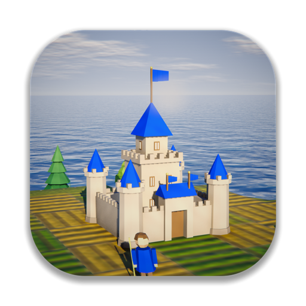
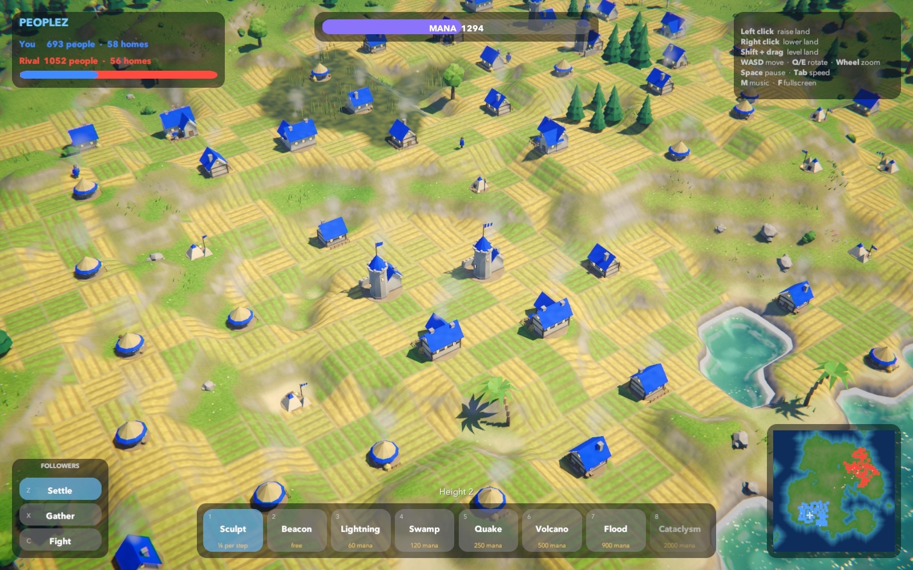
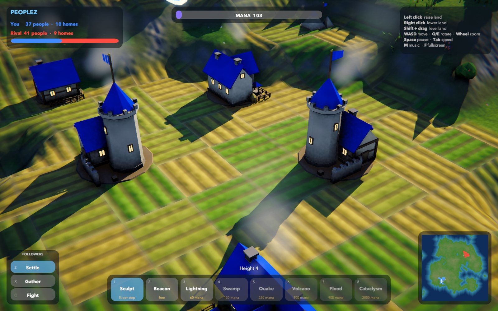
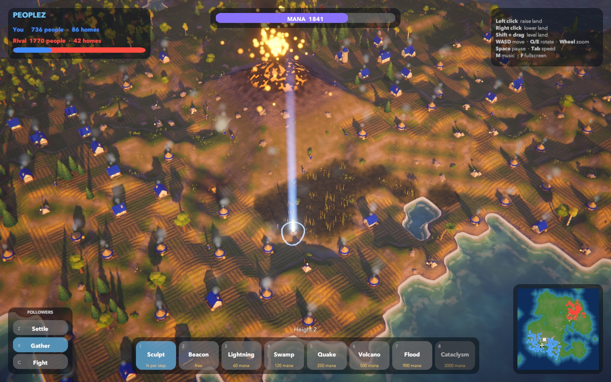
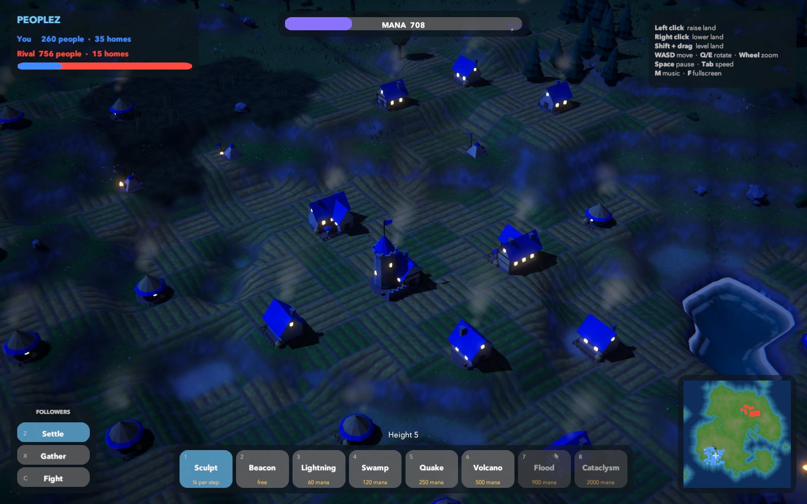
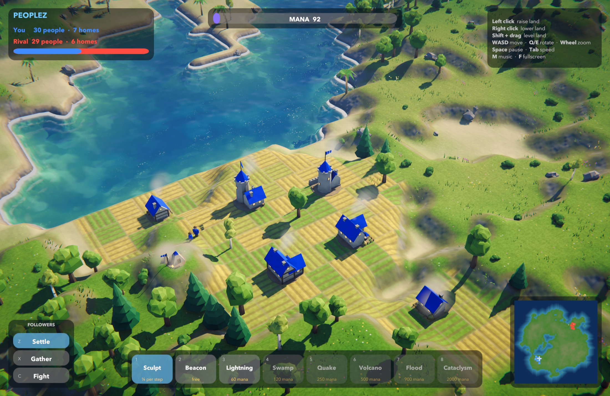

<p align="center"></p>

# PeopleZ

A god game for macOS in the tradition of the classic land-sculpting games: shape the land, guide your people, outlast the rival god.

Built with Unity 6 (URP) on Metal. Everything in the game is generated in code at run time: terrain, models, shaders, sound effects and the music. There are no imported art or audio assets.



## Download

Get `PeopleZ-macOS.zip` from the [latest release](https://github.com/lydianb79/PeopleZ/releases/latest), unzip it and open `PeopleZ.app`.

- Requires an Apple Silicon Mac running macOS 12 or later.
- The game always starts fullscreen at the display's native resolution. Press **F** to switch to a window and back.
- The app is not notarised by Apple, so macOS will refuse to open it the first time. Either open **System Settings → Privacy & Security** and choose **Open Anyway**, or remove the quarantine flag:

```bash
xattr -dr com.apple.quarantine PeopleZ.app
```

## How to play

Your followers (blue) wander until they find flat ground, then settle. The flatter the land around a home, the bigger it grows, from a camp up to a castle, and the more people and mana it produces. Full homes send out new followers to settle further.

You do not control followers directly. You raise and lower the land to give them room, tell them whether to settle, gather or fight, and spend mana on divine powers. A rival god does the same for the red tribe.

**You win when the red tribe has no settlements and no followers left.** You lose the same way.

### Controls

| Input | Action |
|---|---|
| Left click / right click | Raise / lower land |
| Shift + drag | Level land to the height where the drag started |
| W A S D or arrow keys | Move the camera |
| Q / E, or middle-mouse drag | Rotate |
| Mouse wheel | Zoom |
| 1 – 8 | Select a power |
| Z / X / C | Followers: settle / gather at the beacon / fight |
| Space | Pause |
| Tab | Toggle 3× speed |
| M | Music on / off |
| F | Fullscreen / window (the game always starts fullscreen) |

### Powers

| Key | Power | Mana | Effect |
|---|---|---|---|
| 1 | Sculpt | ¼ per changed point | Raise or lower the land |
| 2 | Beacon | free | Place a rally point; followers in Gather mode walk to it and merge into stronger groups |
| 3 | Lightning | 60 | Kills followers and damages a home at the strike point |
| 4 | Swamp | 120 | Turns flat land into swamp that swallows anyone who walks into it |
| 5 | Quake | 250 | Churns the land in a wide radius, ruining flat ground |
| 6 | Volcano | 500 | Raises a burning mountain |
| 7 | Flood | 900 | Lowers all land by one level; everything at sea level drowns, on both sides |
| 8 | Cataclysm | 2000 | Empties every home and forces both tribes into a final battle |

Followers who win a siege capture the building rather than destroying it.

## Features

- **Sculptable world** on a 128 × 128 height grid, rendered as a smooth mesh, with trees, rocks, grass, flowers and reeds scattered across it.
- **Six settlement tiers**, each in two variants, with banners, chimney smoke and windows that glow at night.
- **Rival AI** that flattens its own land, switches between settling and war, and casts powers at you.
- **Day and night cycle** of about nine minutes, with dusk light, moonlight and stars.
- **Rendering:** HDR, soft cascaded shadows, ambient occlusion, bloom, depth of field, drifting cloud shadows, and water with refraction, shore foam and screen-space reflections.
- **Adaptive music** synthesised live: strings, choir, harp and flute by day, bells at night, and war drums that come in as fighting spreads.
- **Positional sound effects and ambience:** sea, wind, birdsong and crickets mixed according to where the camera is and the time of day.

## Screenshots

| | |
|---|---|
|  |  |
|  |  |

The start of a game, captured fullscreen at native resolution:



## Building from source

You need Unity **6000.6.9f1** with the Mac build module.

From the Unity editor, open the project and choose **PeopleZ → Build macOS App**. From a terminal:

```bash
/Applications/Unity/Hub/Editor/6000.6.9f1/Unity.app/Contents/MacOS/Unity -batchmode -quit -projectPath . -executeMethod PZBuilder.BuildAll
```

Either way the app is written to `Build/PeopleZ.app`. The build script also creates the render pipeline settings and the single scene, so a fresh clone needs no manual setup.

### Project layout

| Path | Contents |
|---|---|
| `Assets/Scripts/World.cs` | Height grid, sculpting rules, path-finding fields |
| `Assets/Scripts/Sim.cs` | Followers, settlements, combat, powers, rival AI |
| `Assets/Scripts/TerrainView.cs` | Terrain mesh and scattered scenery |
| `Assets/Scripts/Meshes.cs` | Procedural models: buildings, followers, flora |
| `Assets/Scripts/Audio.cs` | Sound-effect synthesis, ambience and the music engine |
| `Assets/Scripts/Fx.cs` | Particles, lightning, cursor rings, camera |
| `Assets/Scripts/Hud.cs` | Interface and minimap |
| `Assets/Scripts/Game.cs` | Start-up, input, day and night cycle, post-processing |
| `Assets/Resources/Shaders/` | Terrain, water, sky, object and effect shaders |
| `Assets/Editor/PZBuilder.cs` | Project setup and build script |

### Test flags

The built app accepts a few command-line flags used for automated checks:

| Flag | Effect |
|---|---|
| `-pzseed N` | Use a fixed map seed |
| `-pzfast S` | Simulate S seconds before the first frame |
| `-pztime T` | Start at time of day T (0 sunrise, 0.7 sunset) |
| `-pzzoom D` | Start at camera distance D |
| `-pzshot file.png` | Save a screenshot after a few seconds, then quit |
| `-pzwav file.raw` | Record 45 seconds of the music as raw 16-bit stereo, then quit |
| `-pzicon file.png` | Render the app icon, then quit |
